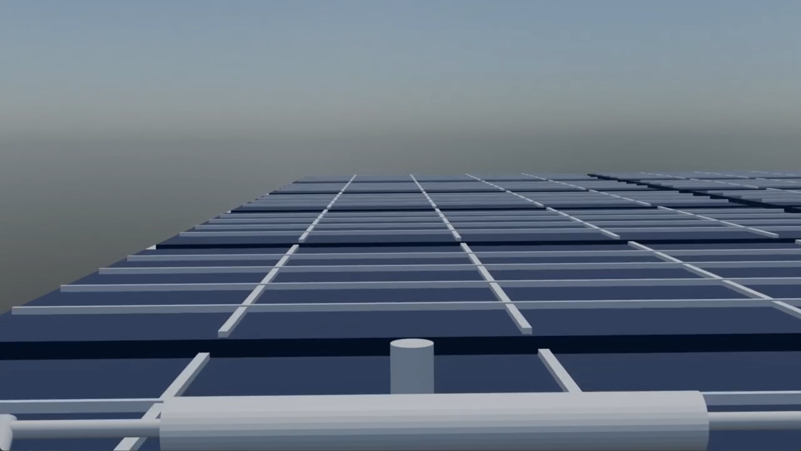
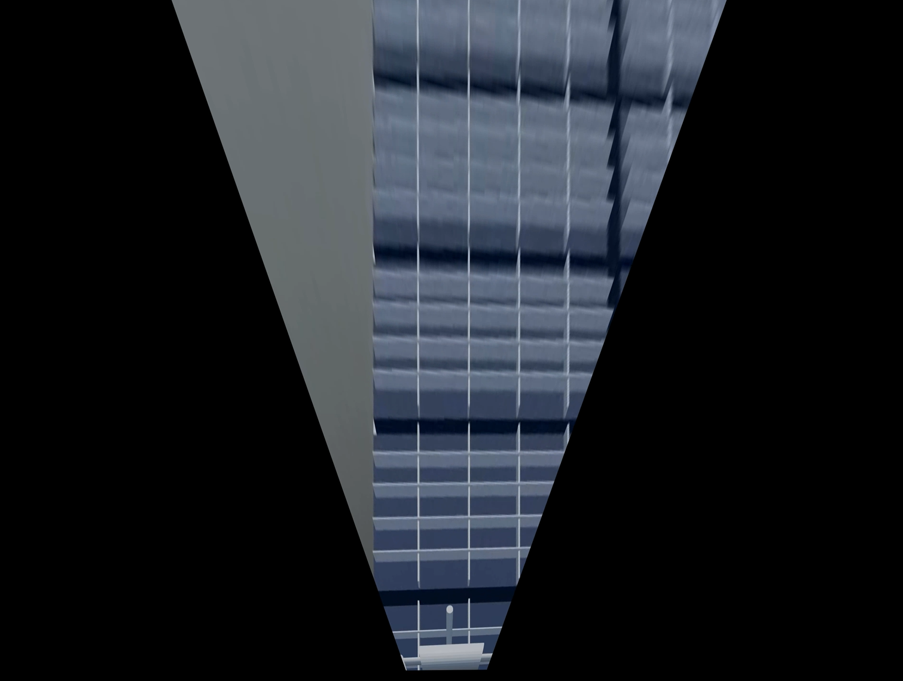
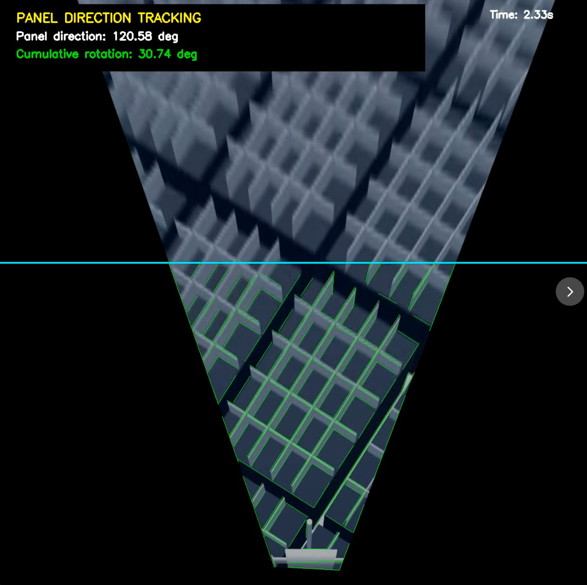
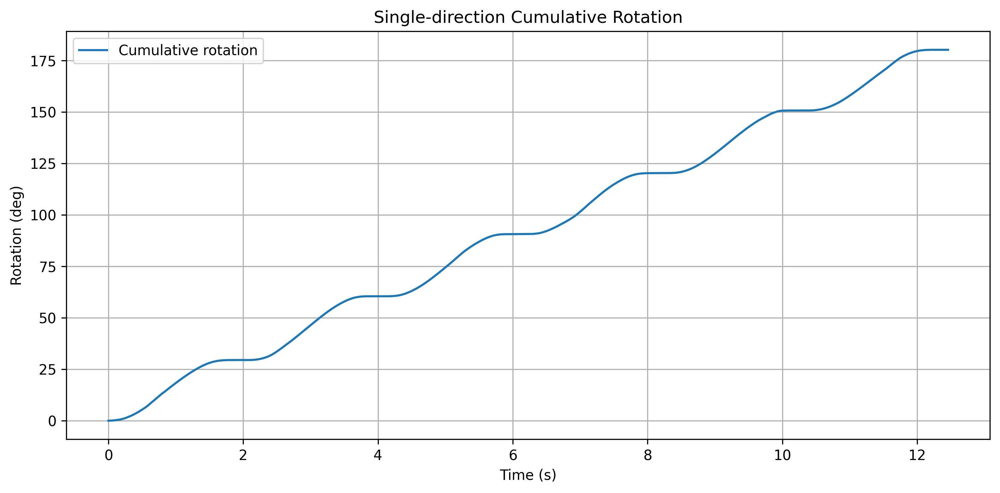
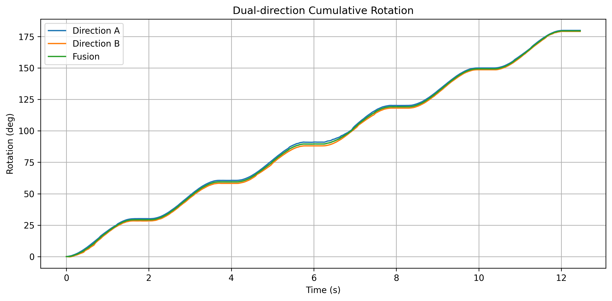
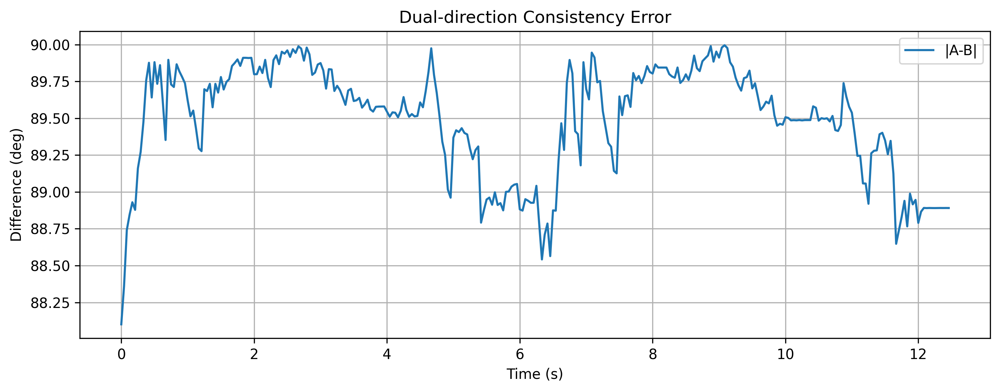

# Photovoltaic Panel Rotation Angle Estimation

**从光伏板结构线的方向变化，估计清洗机器人的旋转角度。**

A vision-based approach that recovers a cleaning robot's rotation angle from the orientation change of photovoltaic (PV) panel structure lines, using LSD line detection plus circular statistics — no IMU, no encoder, no extra hardware.

> 本科毕业设计 / FSDM 2026 投稿工作 · 作者：蔡依思 · 韩山师范学院 软件工程

---

## 效果预览

| 原始机器人视角 | 鸟瞰图（BEV）变换后 |
|---|---|
|  |  |

LSD 结构线检测结果：



---

## 核心结果

实验在 6 组旋转序列（30°、60°、90°、120°、150°、180°）上验证，与真实旋转角度逐帧对比：

| 指标 | 单方向累积法 | 双方向跟踪法 |
|---|---|---|
| 平均绝对误差 (MAE) | **0.073°** | 0.415° |
| 最大误差 | **0.126°** | 0.50° |
| A/B 一致性误差 | — | 可作为结果可信度的辅助判据 |

两种方法的角度曲线：

| 单方向 | 双方向 |
|---|---|
|  |  |

双方向法额外输出的 A/B 方向一致性误差，用于判断当前帧结果是否可信：



**结论**：单方向累积法在数值精度上明显更优；双方向法误差略大，但提供了不依赖真值的自检信号，适合现场无真值条件下的可靠性评估。

---

## 方法概述

整体流程：`视频帧 → 鸟瞰变换 → 灰度 → LSD 直线检测 → 方向直方图 → 主方向提取 → 角度累积`

### 1. 视角归一化
机器人车载相机存在透视，先把图像变换到鸟瞰视角（BEV），使光伏板结构线在图像中保持平行/垂直的规整分布，抑制透视引起的角度偏差。

### 2. LSD 结构线提取
用 OpenCV 的 `cv2.createLineSegmentDetector` 提取短线段，按线段长度加权，构建 0°–180° 的方向直方图，再做高斯平滑后取峰。

### 3. 无向角度的周期处理
结构线是**无向直线**，角度在 180° 处回绕，直接做算术平均会在 0°/180° 附近产生跳变。因此：

```python
def angle_diff_180(a, b):
    return (b - a + 90.0) % 180.0 - 90.0        # 映射到 [-90, 90)，保证差分连续

def circular_mean_180(angles, weights):
    r = np.deg2rad(2.0 * a)                     # 2θ 空间做加权平均，正确处理周期性
    ...
```

角度差分与圆均值都在 2θ 空间完成，避免回绕错误。这一处理是整套方法能稳定工作的关键。

### 4. 单方向累积法
跟踪一个主方向 θ(t)，逐帧累加 `angle_diff_180(θ(t), θ(t-1))`，得到连续旋转角。

### 5. 双方向跟踪法
同时跟踪两个近似垂直的方向族 A、B，各自独立累积后加权融合；两者之差即为 A/B 一致性误差——机器人被遮挡或纹理不足时，该值会明显上升。

---

## 仓库结构

```
.
├── code/
│   ├── single_algorithm.py      # 单方向累积法
│   └── double_algorithm.py      # 双方向跟踪法 + A/B 一致性评估
├── fig/                         # 论文插图（结果曲线、流程图、检测示例）
├── document.tex                 # 论文 LaTeX 源码
├── 基于光伏板结构线方向的机器人旋转角度视觉检测算法研究.pdf   # 论文全文
└── README.md
```

---

## 快速开始

### 环境

```bash
pip install opencv-python numpy matplotlib scipy
```

*Python 3.9 测试通过*

### 准备数据

仓库不包含实验视频（体积原因）。将鸟瞰视角视频放到 `code/` 目录下，例如 `180度旋转鸟瞰图.mp4`。

### 运行

```bash
cd code
python single_algorithm.py     # 单方向累积法
python double_algorithm.py     # 双方向跟踪法
```

两个脚本均通过文件顶部的常量配置，运行前按需修改：

| 常量 | 含义 |
|---|---|
| `VIDEO_PATH` | 输入鸟瞰视频路径 |
| `SAVE_VIDEO` | 是否输出带标注的结果视频 |
| `OUTPUT_CSV` | 逐帧角度结果（`frame, time_s, panel_direction_deg, cumulative_rotation_deg, confidence, valid`） |
| `OUTPUT_VIDEO` | 标注后视频路径 |

### 输出

- **CSV**：逐帧方向角、累计旋转角、置信度、有效标志
- **MP4**：把检测到的结构线与当前角度叠加回原视频，便于肉眼核对
- **PNG**：角度随帧变化的曲线图

---

## 已知局限

诚实说明比包装更能体现工程判断：

1. **数据以仿真为主**：主体实验基于 Blender 渲染的鸟瞰视频真值，实拍场景的鲁棒性仍需更多验证。
2. **依赖结构线可见**：当光伏板被大面积遮挡、或画面内结构线少于阈值时，方向估计会失效，此时 `valid` 标志为 0。
3. **大角度旋转的累积漂移**：单方向累积法本质是增量积分，长序列下误差会缓慢累积，需要定期用绝对方向做校正。
4. **实时性未优化**：当前实现逐帧处理，未做多线程/降采样优化，未在嵌入式平台验证。

---

## 后续计划

- [ ] 增加实拍数据验证，补充真实场景误差统计
- [ ] 用 C++ + OpenCV 重写 LSD 管线，验证工业部署可行性
- [ ] 加入 IMU 融合，抑制长序列累积漂移

---

## 参考

- Grompone von Gioi, R., et al. *LSD: a Line Segment Detector.* IPOL, 2012.
- OpenCV 官方文档：`cv2.createLineSegmentDetector`

## 许可

本仓库代码与论文用于学术交流与求职展示，引用请注明出处。
